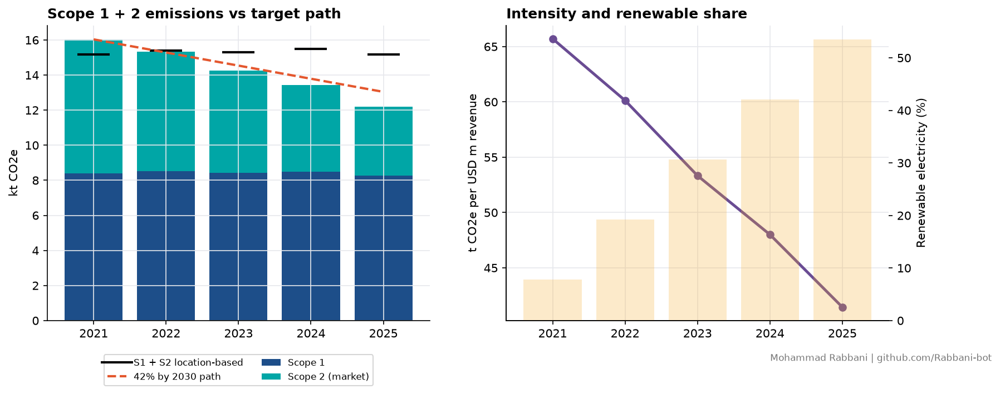
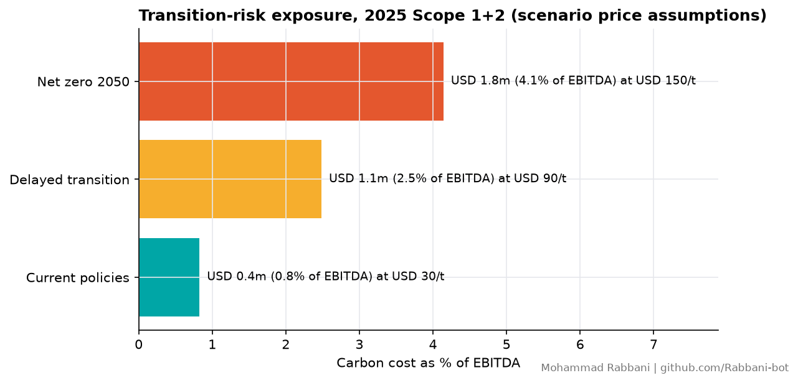

# TCFD-aligned emissions tracking and transition-risk metrics

[](https://github.com/Rabbani-bot/esg-emissions-tracking/actions/workflows/build.yml)  

> **Case company.** A modelled four-unit manufacturer (Textiles, Packaging, Logistics, Offices) with quarterly activity data for 2021-2025, generated with a fixed seed so every figure and table regenerates exactly. Carbon prices are stated scenario assumptions, not forecasts.



## What it does
| TCFD pillar | Implementation |
|---|---|
| Metrics & targets | Scope 1, Scope 2 (location- and market-based), intensity per USD m revenue, renewable electricity share, year-on-year change |
| Targets | Linear path to a 42% absolute Scope 1+2 cut from 2021 to 2030 (the SBTi 1.5°C near-term rate); variance against the path each year |
| Strategy (transition risk) | Carbon-cost exposure under three price assumptions (USD 30 / 90 / 150 per t), as a share of EBITDA |
| Risk management (data) | Automatic gap detection, documented imputation (same unit, same quarter, previous year), completeness score |

## Results (computed by the code)
| Metric | 2021 | 2025 |
|---|---|---|
| Scope 1 + 2, market-based (t CO2e) | 16,037 | 12,190 (−24.0%) |
| Intensity (t CO2e per USD m) | 65.7 | 41.4 |
| Renewable electricity | 7.8% | 53.5% |
| Position vs 42% target path | — | 6.5% below the path (on track) |
| Data completeness | — | 98.75% (2 gaps detected and imputed) |

Decarbonisation so far comes almost entirely from Scope 2 (renewable electricity); Scope 1 is flat. Hitting the 2030 target needs fuel switching or electrification in Logistics and Textiles.



At USD 150/t, 2025 Scope 1+2 emissions would cost about USD 1.8m a year, 4.1% of EBITDA (EBITDA assumed at 15% of revenue).

## Reproduce
```bash
pip install -r requirements.txt
python src/run.py          # regenerates data/ and outputs/
python -m pytest -q tests  # 6 tests: reproducibility, gap handling, dual Scope 2, target path, intensity, carbon cost
```
On every push, GitHub Actions reruns the analysis and tests on Python 3.11 and 3.12 and commits the regenerated outputs.

## Assumptions
- Grid factor 0.45 t/MWh (location-based) and residual-mix factor 0.55 t/MWh (market-based) are representative values; replace them with the official national factors for real reporting.
- Contractual renewable electricity is counted at zero emissions under the GHG Protocol Scope 2 Guidance.

## License
MIT. Cite via `CITATION.cff`.
